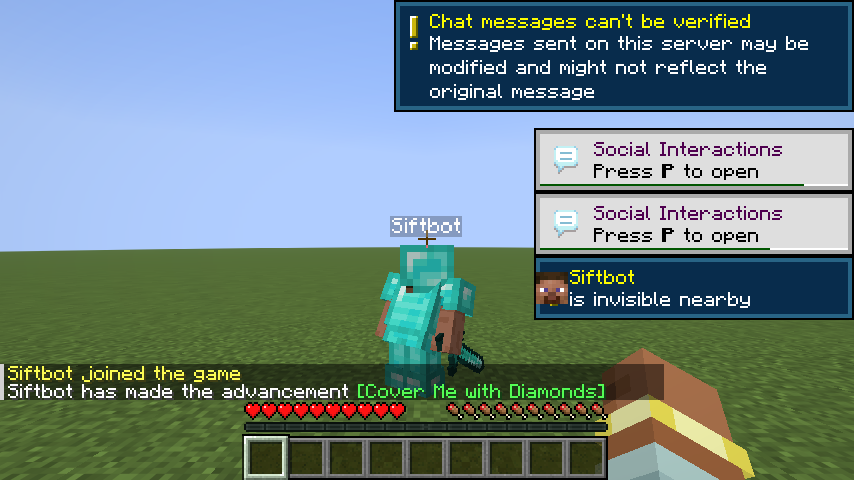
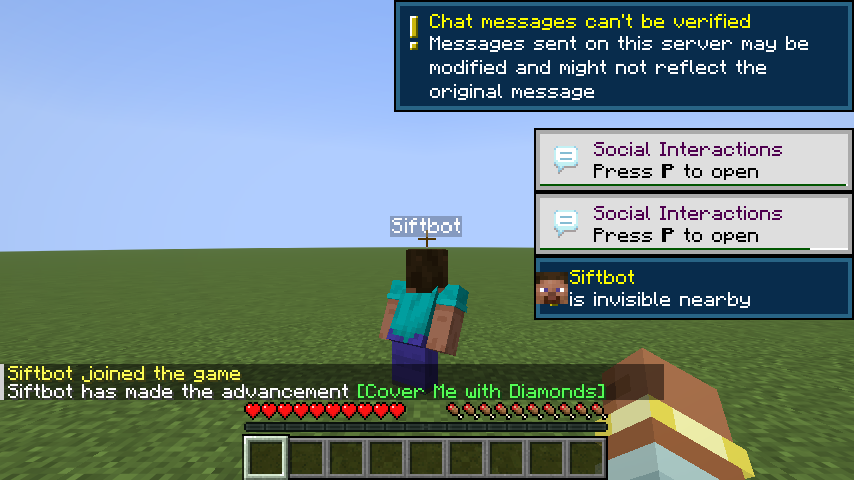

# InvisTags 1.3.0

A structure release. No new toggles and no new commands. The mod behaves the same, except for one visual fix and one reset fix.

## Through-wall nametags are vanilla again

The 1.2.0 build brightened the see-through copy of every nametag in the game, not just invisible players'. That copy is drawn at 50% alpha on purpose, so players behind walls showed up too bright. The mixin that did it is gone. A forced label on an invisible player still renders normally, and its through-wall copy keeps the alpha vanilla gives it.

## Gear reveal no longer touches the player entity

The old code put your cached gear onto the player for one frame and then took it off again. If rendering failed in between, the client kept the swapped equipment. The cache now writes into the render state after vanilla extracts it, so there is nothing to undo. Armour, main hand and off hand still come back.

Both images are the same server tick after the server emptied every equipment slot. With the toggle off you see the bare skin.

## Smaller fixes

- Reset in the config screen now restores the same defaults the mod starts with: everything off except Remember state. It used to turn skin and nametag on.
- A crouching invisible player keeps the through-block nametag copy, the same as a standing one.
- `/invis config`, the toggle subcommands, the config screen and `invistags.json` now all come from one list of toggles, so they cannot drift apart.

## Tested

- 41 unit tests on config persistence, the toggle list, toast episodes and the label rule.
- Client gametest on 1.21.11: config screen, `/invis`, an invisible custom-named mob, and a toast.
- Two clients over the network: a siftbot client on a second machine joined the local server, took diamond gear, turned invisible, and had the gear stripped server-side. The screenshots above come from that run.

## Compatibility

| | |
|---|---|
| Minecraft | 1.21.11 |
| Loader | Fabric Loader 0.19.3+ |
| Required | Fabric API, Cloth Config |
| Optional | Mod Menu |

This jar is the 1.21.11 build. The 26.x branches publish their own jars.
