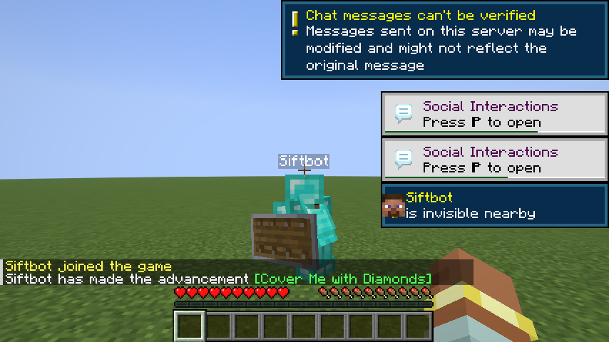
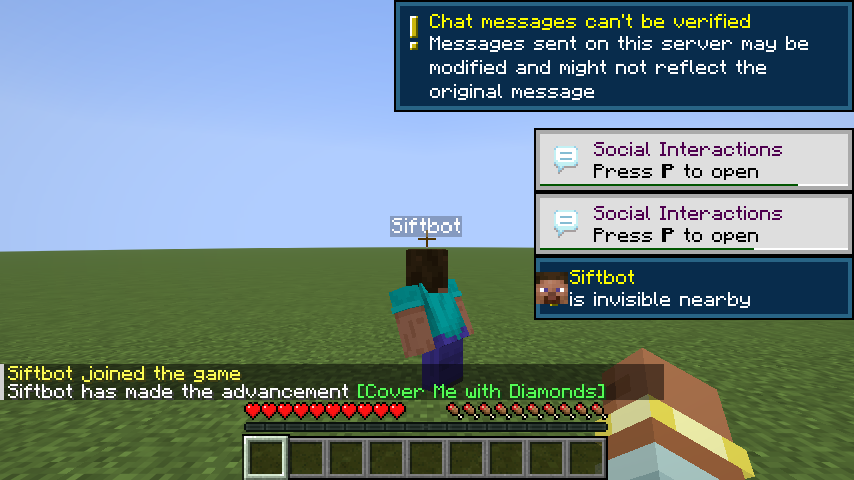

# InvisTags 1.3.1

Fixes for the 1.3.0 render changes. No new toggles or commands.

## Nametags follow vanilla rules again

Forcing a label now only overrides the invisibility check. Team visibility rules, the F1 HUD state, passengers, the camera entity check and the 64-block name-tag limit all still decide whether a label appears. In 1.3.0 a forced label ignored all of them.

A custom-named mob now needs its name to be visible (`CustomNameVisible`) before the mod forces a label. A hidden custom name stays hidden.

## Reveals no longer leak into other render passes

The skin reveal used to clear the shared invisibility flag for the whole frame. It now clears it only for the model pass and restores it afterwards, so capes, ears and mob details keep rendering and other features see the real value. The toast and gear toggles also keep their state when you turn them off, so turning them back on does not re-announce a player or forget cached gear.

## Gear reveal improvements

Restored hand items now move the arm holding them. Before, a revealed sword or shield hung at the player's side because vanilla had already chosen a pose from the stripped stack.

Both images are the same server tick with every equipment slot emptied server-side. The two-player test now also checks that all six cached slots fill the render state before those screenshots are taken.

## Smaller fixes

- The invisible-player toast keeps its episode for 100 ticks (five seconds) when a player leaves the client's tracked range, so a short range gap does not fire a second toast.
- `/invis` reports whether a change was saved, not saved because Remember state is off, or failed to write.
- Config read and write failures log the cause instead of a bare warning.
- The 1.3.0 note about labels working "regardless of render distance" was wrong: the vanilla 64-block name-tag limit still applies.

## Tested

- 46 unit tests on config persistence, the toggle list, toast episodes, the label rule and the player filter.
- Client gametest on 1.21.11: config screen, `/invis`, an invisible custom-named mob, and a toast.
- Two clients over the network: a siftbot client on a second machine joined the local server, took diamond gear, turned invisible, and had the gear stripped server-side. The screenshots above come from that run.

## Compatibility

| | |
|---|---|
| Minecraft | 1.21.11 |
| Loader | Fabric Loader 0.19.3+ |
| Required | Fabric API, Cloth Config |
| Optional | Mod Menu |

This jar is the 1.21.11 build. The 26.x branches publish their own jars.
